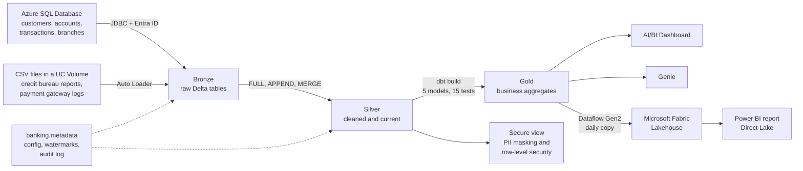

# NeoBank Data Platform on Databricks

An end-to-end banking data platform built on Azure Databricks. It ingests customer, account and transaction data from an Azure SQL Database and partner CSV files, models it through a Bronze, Silver and Gold lakehouse, tests the business layer with dbt, protects customer PII with Unity Catalog, and serves the results through an AI/BI dashboard, a Genie AI assistant, a Microsoft Fabric Lakehouse with a Power BI report, and an automated email report after every run.

The ingestion pipeline is metadata-driven: adding a new source table means adding a few rows to a config table, not writing a new notebook.

**Tech stack:** Azure Databricks, PySpark, Spark SQL, Delta Lake, Auto Loader, Unity Catalog, Databricks Workflows, dbt (dbt-databricks), Azure SQL Database, Microsoft Entra ID, Microsoft Fabric (Lakehouse, Dataflow Gen2), Power BI

---

## Contents

- [The idea behind it](#the-idea-behind-it)
- [Architecture](#architecture)
- [Data sources](#data-sources)
- [How the pipeline works](#how-the-pipeline-works)
- [Gold layer with dbt](#gold-layer-with-dbt)
- [Data governance](#data-governance)
- [Reporting](#reporting)
- [Microsoft Fabric](#microsoft-fabric)
- [Orchestration](#orchestration)
- [Problems found and fixed](#problems-found-and-fixed)
- [Repository structure](#repository-structure)
- [How to run it](#how-to-run-it)
- [Known limitations and next steps](#known-limitations-and-next-steps)
- [Skills demonstrated](#skills-demonstrated)

---

## The idea behind it

Imagine a digital bank called NeoBank. Its core banking data (customers, accounts, transactions, branches) lives in a SQL database, while credit bureau reports and payment gateway logs arrive as CSV files from outside partners. Leadership wants one trusted place to answer questions like:

- Which branches hold the most deposits and process the most transactions?
- Which customers are high risk based on their credit bureau data?
- How are the payment gateways performing, and how often do payments fail?
- What do daily KPIs look like across the whole bank?

This project builds that place, and runs it as a scheduled, tested and monitored pipeline rather than a set of one-off notebooks.

---

## Architecture



| Layer | Schema | Built with | Purpose |
|---|---|---|---|
| Bronze | `banking.bronze` | PySpark, JDBC, Auto Loader | Raw data exactly as received, plus an ingestion timestamp |
| Silver | `banking.silver` | PySpark, Delta MERGE | Cleaned, deduplicated, kept up to date |
| Gold | `banking.gold` | dbt | Business-ready aggregates, tested on every run |

---

## Data sources

| Source | Tables | How it is ingested |
|---|---|---|
| Azure SQL Database | customers, accounts, transactions, branches | Spark JDBC, authenticated as a Microsoft Entra ID service principal |
| CSV files in a Unity Catalog Volume | credit_bureau_reports, payment_gateway_logs | Auto Loader (incremental file ingestion) |

The pipeline processes 50,000+ banking records across these six tables.

---

## How the pipeline works

### 1. A metadata layer that drives ingestion

Instead of hardcoding table names and logic in each notebook, the pipeline reads its instructions from four Delta tables in `banking.metadata`:

| Table | What it holds |
|---|---|
| `tables` | Every source table: where it comes from, which schemas to use, whether it is active and in what order to load it |
| `table_parameters` | Per-table settings such as load type, primary key and watermark column |
| `table_watermarks` | The last value loaded for each incremental table, so the next run only picks up new data |
| `pipeline_runs` | An audit log of every load: start and end time, status, record count and error message |

### 2. Source to Bronze

A Databricks Workflow reads the list of active tables and loops over them with a For Each task, passing each table's metadata between tasks with task values.

For **SQL tables**, the notebook requests an OAuth access token from Microsoft Entra ID with a service principal (using MSAL) and connects to Azure SQL over an encrypted JDBC connection. Only rows newer than the stored watermark are queried, so incremental tables are never fully re-read.

For **CSV files**, Auto Loader picks up only new files from the Volume, tracks progress with checkpoints and runs with an `availableNow` trigger, so it behaves like a batch job while keeping exactly-once file tracking.

Everything lands in Bronze as raw Delta tables with an `insert_timestamp`.

### 3. Bronze to Silver

Each table is loaded into Silver according to its configured strategy:

| Load type | Used for | What happens |
|---|---|---|
| FULL | branches | Silver is replaced with only the most recent load from Bronze |
| APPEND | transactions, payment gateway logs | New rows are added, since events never change once they happen |
| MERGE | customers, accounts, credit bureau reports | Delta MERGE upserts: existing records are updated, new ones inserted |

After a successful load, the watermark moves forward and the run is recorded in `pipeline_runs`. Every step is wrapped in try/except/finally, so a failure is always logged with its error message rather than disappearing silently.

---

## Gold layer with dbt

The Gold layer is a dbt project (`dbt_finance/`) that reads the Silver tables and builds five Gold tables as Delta tables. It replaced the original notebook-based Gold layer.

| Gold model | What it answers |
|---|---|
| `customer_360` | One row per customer: accounts, balances, transaction totals, latest credit score (picked with `ROW_NUMBER()`) and a value segment |
| `branch_performance` | Customers, accounts, deposits and transaction volume per branch |
| `daily_bank_kpi` | Daily transaction counts and amounts alongside bank-wide totals |
| `risk_customer_summary` | Customers grouped by credit risk grade, with average credit score, external loans and overdue amounts |
| `transaction_channel_summary` | Daily transactions by payment gateway and device type, with successful vs failed payments and average processing time |

### Why dbt

- **Lineage:** every model references its inputs with `{{ source() }}`, so dbt knows the dependency graph, builds models in the right order and generates a lineage diagram.
- **Tests on every run:** 15 data tests check the data before anyone sees it on a dashboard.
- **Version-controlled SQL:** each model is a plain `SELECT` in its own file, which is easy to review and change.

### Tests

| Where | Tests | Severity |
|---|---|---|
| Silver sources | `unique` and `not_null` on the keys of customers, accounts, transactions and branches (8 tests) | `warn`: reported, but don't stop the run, because Silver belongs to the ingestion pipeline |
| Gold models | `unique` / `not_null` on `customer_360.customer_id`, `branch_performance.branch_code`, `daily_bank_kpi.txn_date`, `risk_customer_summary.risk_grade`, and `not_null` on `transaction_channel_summary.total_transactions` (7 tests) | `error`: the job fails before bad numbers reach reporting |

### Dev and prod

| Environment | Where it runs | Writes to |
|---|---|---|
| Dev | dbt Core on my laptop, using a local `profiles.yml` kept outside the repo | `banking.gold_dbt` |
| Prod | A dbt task in the Databricks job, on a serverless SQL warehouse | `banking.gold` |

Changes are tested with `dbt build` in dev first, and only the scheduled job writes to the production Gold schema.

<!-- Add your screenshot to screenshots/ or delete this line -->


---

## Data governance

Customer PII is protected with Unity Catalog. A secure view over `silver.customers` applies:

- **Column masking:** SQL functions mask PAN numbers (`XXXXXX1234`), emails (`v*****@gmail.com`) and phone numbers, and show only the year of birth.
- **Row-level security:** each user only sees customers from the branches assigned to them.
- **Config-driven access:** a `user_access` table controls who sees which branch and whether they can view raw PII. Changing someone's access is a one-row update.

A branch analyst sees masked data for their own branch only, while a compliance officer sees everything.

Outside Databricks, only aggregate Gold tables are shared. `customer_360`, which contains customer names, is deliberately left out of Microsoft Fabric and Power BI.

---

## Reporting

| Output | What it does |
|---|---|
| **AI/BI Dashboard** | Executive, branch, customer and credit risk views built on the Gold tables |
| **Genie** | A Genie space over the Gold tables, so business users can ask questions in plain English, such as "which branch had the highest deposits?" |
| **Power BI report (Fabric)** | Built in Microsoft Fabric on a Direct Lake semantic model over the Fabric Lakehouse: total deposits, deposits by branch, daily transaction value, customers by risk grade and payment gateway performance |
| **Power BI Desktop file** | The same report as a `.pbix` (Import mode, connected straight to the Databricks SQL warehouse), so it can be opened and refreshed without Fabric |
| **Email run report** | After every run, a notebook reads the audit log and sends a styled HTML email with the overall status and a per-table breakdown of records loaded and any errors |

<!-- Add your screenshot to screenshots/ or delete this line -->


---

## Microsoft Fabric

The Gold layer is shared with Microsoft Fabric for business reporting:

1. **Dataflow Gen2** (`Load NeoBank Gold`) connects to the Databricks SQL warehouse with the Azure Databricks connector and copies four Gold tables: `branch_performance`, `daily_bank_kpi`, `risk_customer_summary` and `transaction_channel_summary`.
2. The tables land in a **Fabric Lakehouse** (`neobank_lakehouse`) as Delta tables, replaced on every refresh. The dataflow refreshes daily, after the Databricks job has finished.
3. The Lakehouse's **SQL analytics endpoint** lets analysts query the tables with T-SQL.
4. A **Direct Lake semantic model** (`NeoBank Gold Model`) on the Lakehouse powers the Power BI report, reading the Delta tables directly without a separate import.

Why a copy rather than mirroring: the `banking` catalog uses Databricks default storage, which doesn't support the credential vending that Fabric mirroring needs (see [Problems found and fixed](#problems-found-and-fixed)). Dataflow Gen2 reads through the SQL warehouse instead, which default storage supports.

<!-- Add your screenshot to screenshots/ or delete this line -->


---

## Orchestration

The whole pipeline runs as one Databricks Workflow:

1. **Read tables list:** reads the active tables from the metadata layer.
2. **For Each table:** reads that table's parameters, loads Source to Bronze, then Bronze to Silver.
3. **dbt_gold:** runs `dbt build` on a serverless SQL warehouse, building and testing all Gold models.
4. **Send_Email:** sends the HTML run report.

After the job, the Fabric Dataflow Gen2 refreshes on its own daily schedule, copying the new Gold tables into the Lakehouse, and the Direct Lake report picks them up automatically.

---

## Problems found and fixed

Real issues that came up while building this, and how they were solved:

**Duplicate branches inflating metrics.** Bronze is append-only, so every FULL load added another copy of the branches table, and Silver was being rebuilt from all of them. This silently multiplied branch-level totals and duplicated customers in `customer_360`. dbt's `unique` test made the problem visible. The fix: FULL loads now take only the latest batch from Bronze (by `insert_timestamp`), and the next run cleans up the old duplicates automatically.

**Text columns from CSV files.** Auto Loader loads CSV columns as strings. SQL warehouses run in ANSI mode, which is stricter about implicit casts, so the dbt models convert columns like `credit_score` and `processing_time_ms` with `TRY_CAST`, and join `txn_id` as text on both sides.

**A typo in production.** The original Gold notebook named a column `ansaction_amount`. The dbt rebuild fixed it to `total_transaction_amount`, and the dashboard datasets were updated to match.

**Microsoft Fabric mirroring isn't possible on default storage.** I first planned to mirror the Gold schema into Microsoft Fabric. The `banking` catalog uses Databricks default storage, which doesn't support the credential vending that mirroring relies on, so the `EXTERNAL USE SCHEMA` grant fails. Default storage does support access through a SQL warehouse, so the design was changed to a Dataflow Gen2 that copies the Gold tables into a Fabric Lakehouse on a schedule.

**Getting a Fabric trial capacity.** Starting the Fabric trial initially failed for the tenant, and the first trial activated was a Power BI individual trial, which only unlocks Power BI Pro workspaces. The report was built first in Power BI Desktop against Databricks, and moved onto the Fabric Lakehouse once a Fabric trial capacity was available.

---

## Repository structure

```
Databricks_Finance_data/
├── Databricks_finance/
│   ├── Setup_Metadata/
│   │   ├── Setup_Metadata.py            # creates the catalog, schemas and metadata tables
│   │   └── Check_Metadata.py            # quick checks of config and audit tables
│   ├── Source_to_Silver/
│   │   ├── 00_Setup_Secret_scope.py     # creates the secret scope (values entered at runtime, never committed)
│   │   ├── 01_Read_Tables_List.py       # reads active tables and passes them to the job
│   │   ├── 02_Read_Table_Parameters.py  # reads load settings for one table
│   │   ├── 03_Source_to_Bronze.py       # JDBC (Entra ID) and Auto Loader ingestion
│   │   └── 04_Bronze_to_Silver.py       # FULL / APPEND / MERGE loads and watermarks
│   ├── Governance/
│   │   └── 01_PII_Masking_and_Access.sql  # masking functions, access table, secure view
│   └── Email_Notification/
│       └── Send_Email.py                # HTML run report
├── dbt_finance/                         # Gold layer
│   ├── dbt_project.yml
│   ├── .gitignore
│   ├── models/
│   │   ├── sources.yml                  # Silver tables and source tests
│   │   └── gold/
│   │       ├── customer_360.sql
│   │       ├── branch_performance.sql
│   │       ├── daily_bank_kpi.sql
│   │       ├── risk_customer_summary.sql
│   │       ├── transaction_channel_summary.sql
│   │       └── schema.yml               # model descriptions and tests
│   └── tests/
├── powerbi/
│   └── NeoBank_Gold_Report.pbix         # Power BI report (no credentials stored)
├── screenshots/
│   ├── dbt_lineage.png
│   ├── fabric_lakehouse.png
│   └── powerbi_report.png
└── README.md
```

---

## How to run it

### Prerequisites

- An Azure Databricks workspace with Unity Catalog and a Serverless or Pro SQL warehouse
- An Azure SQL Database with the source tables, and a Microsoft Entra ID service principal with read access
- Python 3.10+ for dbt (tested with dbt-core 1.12.5 and dbt-databricks 1.12.7)
- A Microsoft Fabric capacity (trial or paid) for the Lakehouse and report
- Power BI Desktop (Windows) for the `.pbix` file

### 1. Set up the pipeline

1. Run `Setup_Metadata/Setup_Metadata.py` once to create the catalog, schemas and config tables. It recreates the metadata tables, so don't re-run it on a live environment.
2. Create the secret scope with your SQL and email credentials (`00_Setup_Secret_scope.py`). Enter the values at runtime and never save them in the notebook.
3. Upload the CSV files to the Unity Catalog Volume.
4. Create the Databricks Workflow with the tasks listed under [Orchestration](#orchestration).

### 2. Set up dbt

```bash
python -m venv .venv
.venv\Scripts\activate          # Windows; on Mac/Linux: source .venv/bin/activate
pip install dbt-databricks==1.12.7
```

Create `~/.dbt/profiles.yml` (outside the repo):

```yaml
dbt_finance:
  target: dev
  outputs:
    dev:
      type: databricks
      catalog: banking
      schema: gold_dbt
      host: <server-hostname>
      http_path: <sql-warehouse-http-path>
      token: <personal-access-token>
      threads: 4
```

Then, from `dbt_finance/`:

```bash
dbt debug    # check the connection
dbt build    # build all models and run all tests in banking.gold_dbt
dbt docs generate && dbt docs serve    # optional: lineage graph
```

To run it in production, upload the project to the Databricks workspace and add a **dbt** task to the job, with the command `dbt build`, catalog `banking` and schema `gold`.

### 3. Set up Microsoft Fabric

1. In a Fabric workspace on a Fabric capacity, create a **Lakehouse** named `neobank_lakehouse`.
2. Create a **Dataflow Gen2**, connect it to the Databricks SQL warehouse with the **Azure Databricks** connector (server hostname, HTTP path, personal access token), and select the four aggregate Gold tables.
3. Set each query's data destination to the Lakehouse (new table, replace on refresh), publish, and schedule a daily refresh after the Databricks job.
4. From the Lakehouse, create a **New semantic model** with the four tables and build the report on it.

### 4. Open the Power BI Desktop file

Open `powerbi/NeoBank_Gold_Report.pbix` in Power BI Desktop. When prompted, sign in to Azure Databricks with a personal access token, then click **Refresh**.

---

## Known limitations and next steps

- **`daily_bank_kpi` mixes daily and current values.** Transaction metrics are per day, but customer, balance and credit metrics are current totals repeated on every date. A proper daily snapshot table would fix this.
- **Gold runs don't write to the audit log.** dbt keeps its own run results, so the email report covers Bronze and Silver only. A dbt `on-run-end` hook could write Gold results into `pipeline_runs`.
- **Streaming ingestion.** A planned extension is a Kafka source (for example, real-time card transactions) feeding a new Bronze and Silver table through Structured Streaming.
- **Fabric runs on a trial capacity.** The Fabric workspace uses a 60-day trial; keeping it long term would need a paid Fabric capacity (F2 or larger), which can be paused when idle.

---

## Skills demonstrated

| Area | What I used |
|---|---|
| Data engineering | PySpark, Spark SQL, Delta Lake, Medallion architecture, incremental loads with watermarks, Delta MERGE upserts |
| Ingestion | JDBC with Entra ID token authentication (MSAL), Auto Loader with checkpoints and `availableNow` |
| Pipeline design | Metadata-driven ingestion, audit logging, try/except/finally error handling |
| Analytics engineering | dbt models, sources, data tests, lineage, dev/prod environments |
| Orchestration | Databricks Workflows, For Each tasks, task values, dbt tasks |
| Governance and security | Unity Catalog, PII masking, row-level security, secret scopes, credentials kept out of source control |
| Microsoft Fabric | Lakehouse, Dataflow Gen2 with the Azure Databricks connector, SQL analytics endpoint (T-SQL), Direct Lake semantic model |
| BI and AI | AI/BI dashboards, Genie, Power BI (Fabric and Desktop), scheduled refresh |
| Python | Orchestration logic, token handling, HTML email reports with `smtplib` |
